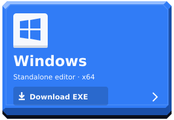
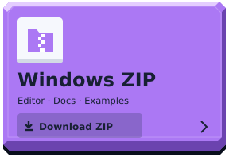
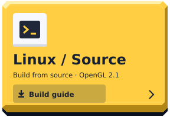

<p align="center">
  
</p>
<h1 align="center">Lunoryx Studio</h1>
<p align="center"><strong>От первой 3D-сцены — до собственной игры в одном EXE.</strong><br/>Моделирование, Lua, анимации, GUI и инструменты сборки в одном редакторе.</p>
<p align="center">
  <a href="https://github.com/kittkanev/Lunoryx/releases/tag/v1.2.2"><strong>Релиз 1.2.2</strong></a> ·
  <a href="#screenshots">Скриншоты</a> ·
  <a href="#first-game">Первая игра</a> ·
  <a href="https://github.com/kittkanev/Lunoryx/issues">Сообщить об ошибке</a>
</p>

<p align="center">
  <a href="https://github.com/kittkanev/Lunoryx/releases/download/v1.2.2/Lunoryx.exe"></a>
  <a href="https://github.com/kittkanev/Lunoryx/releases/download/v1.2.2/Lunoryx-v1.2.2-windows-x64.zip"></a>
  <a href="#build-linux"></a>
</p>
<p align="center">
  <a href="docs/ru/README.md"></a>
  <a href="docs/en/README.md"></a>
</p>

**Windows x64:** OpenGL 2.1 compatibility и framebuffer objects. Редактор запускается без окна консоли и отдельных SDL/Lua/audio DLL. В ZIP входят офлайн-документация, примеры и лицензии. Для Linux доступна сборка из исходников; готовая сборка macOS пока не публикуется.

**English:** a 3D editor with modeling, Lua scripting, object animation, GUI authoring and standalone game builds. [Start with the English handbook](docs/en/README.md).

<p align="center">
  <a href="https://github.com/kittkanev/Lunoryx/releases/download/v1.2.2/render-quality.png"></a>
  <br/><sub>Реальный viewport Lunoryx 1.2.2. GGX PBR, HDR, тональная коррекция, FXAA и тени солнца.</sub>
</p>

## Что нового в 1.2.2

Песочница Lua с лимитами памяти и исполнения, ограничение путей ресурсов,
компактное хранение встроенных файлов, атомарный экспорт GLB и автосохранение
для восстановления работы. [Исправления и ограничения](docs/AUDIT-REMEDIATION.md).

## Возможности редактора

- **Свободная камера:** ПКМ + WASD, Q/E вниз/вверх, Shift ускоряет. Шесть направлений манипулятора: ±X, ±Y, ±Z.
- **Выделение:** Object/Edit, вершины/рёбра/грани, рамка, круг и X-ray.
- **Рендер:** Wireframe, Solid, Material PBR и Rendered PBR; HDR, экспозиция, тональная коррекция и тени.
- **Build Game:** своё название и PNG-иконка, оконный или полноэкранный запуск, разрешение, VSync и выбор выходного EXE.
- **GUI Designer:** текст, кнопки, панели и полосы прогресса; холст, цвета, слои, Undo/Redo и Lua-события.
- **Триггеры:** киллзоны, чекпоинты и скриптовые зоны с событиями `enter / stay / exit`.

Из 1.2.0 сохранены объектные анимации по ключевым кадрам, отладчик с паузой и шагом симуляции, сглаженный шрифт с кириллицей и справка EN/RU.

<a id="screenshots"></a>
## Внутри редактора

Снимки сделаны в версии **1.2.2** во время проверок приложения. Нажмите на изображение, чтобы открыть его полностью.

<table>
  <tr>
    <td width="50%"><strong>GUI Designer</strong><br/>Холст, свойства и слои интерфейса.<br/><a href="https://github.com/kittkanev/Lunoryx/releases/download/v1.2.2/game-ui.png"></a></td>
    <td width="50%"><strong>Build Game</strong><br/>Название, иконка и параметры игрового окна.<br/><a href="https://github.com/kittkanev/Lunoryx/releases/download/v1.2.2/game-build.png"></a></td>
  </tr>
  <tr>
    <td><strong>Моделирование</strong><br/>Работа с мешами, модификаторы и булевы операции.<br/><a href="https://github.com/kittkanev/Lunoryx/releases/download/v1.2.2/modeling.png"></a></td>
    <td><strong>Анимации и отладка</strong><br/>Ключевые кадры, состояние симуляции и встроенные Docs.<br/><a href="https://github.com/kittkanev/Lunoryx/releases/download/v1.2.2/animation-docs.png"></a></td>
  </tr>
</table>

## Что можно создавать

| Инструменты | Возможности |
|---|---|
| **Сцена и управление** | Explorer, свойства объектов, мультивыбор, Move/Rotate/Scale, локальные и мировые оси, привязка и адаптивная сетка |
| **Моделирование** | Вершины/рёбра/грани, Extrude, Weld, Join, удаление и нормали; Mirror, Array, Loop Subdivision, Bevel; Union / Difference / Intersection |
| **Скульптинг и ноды** | Кисти Inflate/Deflate, Smooth, Flatten, симметрия по X; граф геометрии с Preview/Commit и Bake |
| **UV и материалы** | xatlas-развёртка, швы и острова, трансформации UV, материалы по граням, PNG/JPEG-текстуры |
| **Игровые системы** | Lua 5.4, персонаж, AABB-физика, звук, объектные анимации, киллзоны, чекпоинты и скриптовые триггеры |
| **GUI** | Label, Button, Panel, Progress; перетаскивание на холсте, цвета и слои, события и обновления из Lua |
| **Проект и экспорт** | `.lunoryx`, история операций, статический GLB, самостоятельная игра в одном EXE с вложенными ресурсами |
| **Отладка и автоматизация** | Пауза и шаг симуляции, границы коллизий, traceback Lua, MCP stdio со стабильными ID |

<a id="first-game"></a>
## Своя игра за несколько шагов

1. Запустите редактор и откройте **Build Game** в верхнем меню.
2. Нажмите **New third-person example**. **Play Simulation / F6** запускает пример: WASD — движение, Space — прыжок. **Stop** восстанавливает сцену редактора.
3. Создайте интерфейс через **Window → GUI Designer**. Зоны добавляются в **Tools → Build**, тип меняется в **Properties → Trigger**.
4. В **Build Game** задайте название, квадратную PNG-иконку 16–256 px, режим **Fullscreen (desktop)** или **Windowed**, размер окна и стартовый скрипт.
5. Сохраните `.lunoryx`, выберите выходной файл и нажмите **Build standalone Game.exe**. На Windows доступны диалоги выбора иконки и EXE.
6. Перенесите игру в пустую папку: проект, исходные ресурсы и компилятор для запуска не нужны. Esc — выход, R — перезапуск.

[Скачать самостоятельный пример Gem Trail](https://github.com/kittkanev/Lunoryx/releases/download/v1.2.2/GemTrail.exe) · [Инструкция по сборке и GUI](docs/ru/README.md)

<p align="center">
  <a href="https://github.com/kittkanev/Lunoryx/releases/download/v1.2.2/game-windows.png"></a>
  <br/><sub>Gem Trail — игровой пример, собранный в отдельный EXE.</sub>
</p>

## Управление

| Действие | Клавиши и мышь |
|---|---|
| Свободный полёт | Удерживать ПКМ; WASD — движение, Q/E — вниз/вверх, Shift — быстрее, Ctrl — медленнее; колесо меняет скорость |
| Орбитальная камера | Выключить Free Fly: ПКМ — вращение, СКМ — сдвиг, колесо — приближение |
| Трансформации | Q — Select, W — Move, E — Rotate, R — Scale; перетаскивать ось или плоскость манипулятора |
| Редактирование меша | Tab — Object/Edit; 1/2/3 — вершины/рёбра/грани; B — рамка, C — круг, Alt+Z — X-ray |
| Изменение выделения | Shift добавляет, Ctrl убирает; A — всё, Alt+A — снять выделение |
| Код и симуляция | F5 — запуск скрипта, F6 — Play/Stop, F11 — полный экран редактора кода |
| Сохранение и история | Ctrl+S — сохранить проект, Ctrl+Z / Ctrl+Y — Undo/Redo |
| Качество рендера | F8 — Office/Balanced/Quality; настройки — в Settings |

Во время свободного полёта Q/E управляют высотой камеры. Перед ручной правкой сцены остановите симуляцию.

## Lua, GUI и триггеры

Создайте Label с ID `message` и Button с ID `restart` в **GUI Designer**, затем добавьте **Script trigger** в сцену. Назначьте Lua-вкладку стартовым скриптом в **Build Game**:

```lua
function on_trigger(event, zone, actor)
    if zone == find_object('Script trigger') then
        if event == 'enter' then
            gui_text('message', 'Добро пожаловать!')
            gui_visible('message', true)
        elseif event == 'exit' then
            gui_visible('message', false)
        end
    end
end

function on_gui_click(id)
    if id == 'restart' then restart_game() end
end
```

Триггеры автоматически отслеживают динамические объекты, включая персонажей. `set_trigger(index, 3)` создаёт скриптовую зону; `trigger_contains(zone, actor)` проверяет пересечение. `gui_text`, `gui_visible`, `gui_value` изменяют интерфейс. Все индексы объектов в Lua начинаются с **нуля** и сдвигаются при удалении; после изменения состава сцены снова вызывайте `find_object`.

MCP запускается тем же EXE в режиме `--mcp` и работает со стабильными ID:

```json
{"mcpServers":{"lunoryx":{"command":"C:\\Tools\\Lunoryx.exe","args":["--mcp"]}}}
```

[API и примеры на русском](docs/ru/README.md) · [English API guide](docs/en/README.md) · [Пример игры на Lua](examples/collect.lua)

<a id="build-linux"></a>
## Структура репозитория

| Папка | Содержимое |
|---|---|
| `src/core/` | Сцена, геометрия, меши и анимационное ядро |
| `src/editor/` | Панели Studio, инструменты и встроенная документация |
| `src/render/` | Viewport, материалы, HDR и тени |
| `src/runtime/` | Игровые настройки, GUI, триггеры и симуляция |
| `src/scripting/` | Lua API и MCP |
| `src/io/` | Файлы, ресурсы, проекты и упаковка игры |
| `src/examples/`, `src/licenses/` | Встроенные примеры и уведомления о лицензиях |
| `third_party/` | Dear ImGui и внешние заголовочные библиотеки |
| `extensions/` | Аудио, моделирование, ImGuizmo, xatlas и Rust-ядро |
| `assets/`, `config/` | Логотип, шрифт, оформление README и шаблон раскладки |
| `tests/`, `benchmarks/`, `tools/`, `docs/` | Проверки, замеры, сборочные утилиты и руководства |

Вход в приложение — `src/main.cpp`. Команды `make`, `make test` и `make -f Makefile.win package` запускаются из корня.

## Сборка из исходников

<details>
<summary><strong>Linux — Debian / Ubuntu</strong></summary>

```bash
sudo apt-get install -y g++ make cmake curl libsdl2-dev liblua5.4-dev libgl1-mesa-dev
rustup toolchain install 1.85.1 --profile minimal
make -j2
./engine
```

Требуется установленный `rustup`. Manifold 3.5.4 подготавливается автоматически с проверкой SHA-256; xatlas включён в исходники. Основной редактор — C++11, адаптер Manifold — C++17; Rust-ядро Weld линкуется статически.

</details>

<details>
<summary><strong>Windows x64 — кросс-сборка MinGW</strong></summary>

```bash
sudo apt-get install -y cmake curl g++-mingw-w64-x86-64
rustup toolchain install 1.85.1 --profile minimal --target x86_64-pc-windows-gnu
bash tools/prepare_mingw.sh
make -j2 -f Makefile.win package
```

Используется POSIX-вариант MinGW. Готовые файлы находятся в `build/win/`. Для обычного запуска редактора инструменты сборки не нужны.

</details>

<details>
<summary><strong>Проверки и производительность</strong></summary>

```bash
make test test-integration test-rust test-kernels test-physics
make test-postprocess test-render test-shadows
python tools/test_studio_mcp.py ./engine
python tools/test_game_package.py ./engine
```

CI проверяет сборки Linux/MinGW с `-Werror`, нативный запуск на Windows, ASan/UBSan/LeakSanitizer, Lua/MCP, аудио, GLB, совместимость проектов и графические сценарии. Проверяются GUI-ввод, иконка EXE, все шесть направлений манипулятора, триггеры и перенос самостоятельной игры без исходных ресурсов. Windows-графика тестируется через Mesa; этот драйвер не входит в релиз.

[Методика замеров и ограничения](docs/PERFORMANCE.md) · [GitHub Actions](https://github.com/kittkanev/Lunoryx/actions)

</details>

## Документация и границы версии

Справка **EN/RU** встроена в **Window → API Docs**. Офлайн-HTML находится в `docs/en/index.html` и `docs/ru/index.html`; откройте файлы из ZIP в браузере. Лицензии зависимостей доступны внутри редактора и в `docs/licenses`.

Физика использует AABB, анимации — объектные, GLB-импорт — статический. Рендер работает в реальном времени; трассировка лучей, HDRI-отражения, скелетный риг и полная совместимость с Blender пока не реализованы. HDR требует поддерживаемого framebuffer; при его отсутствии используется LDR-путь.

[Релизы и контрольные суммы](https://github.com/kittkanev/Lunoryx/releases) · [Ошибки и предложения](https://github.com/kittkanev/Lunoryx/issues)

Security, Lua sandbox compatibility and autosave recovery: [audit remediation record](docs/AUDIT-REMEDIATION.md).
