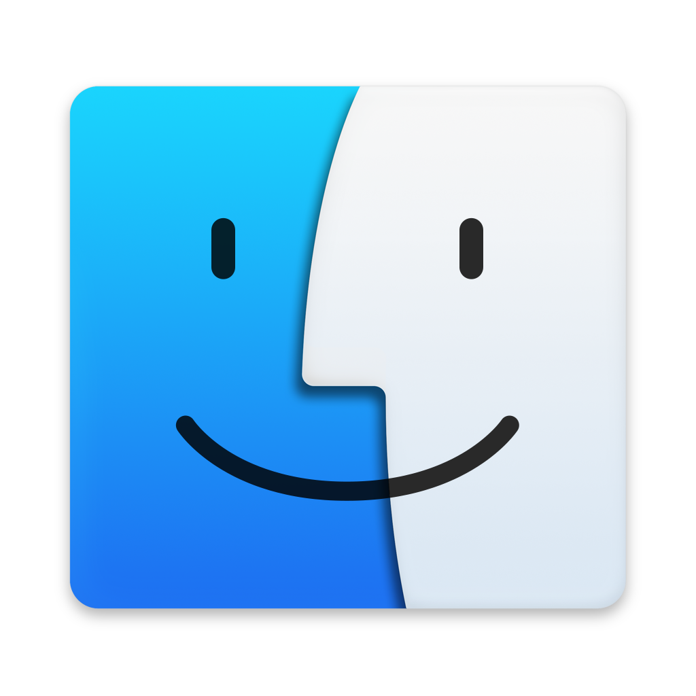

<p align="center"></p>
<h1 align="center">Lunoryx Studio</h1>
<p align="center"><a href="README.md">English</a> · <a href="README.ru.md">Русский</a></p>

3D scene creation, modeling, animation, scripting and standalone games in one editor.

<table align="center">
<tr>
<td align="center"><a href="https://github.com/kittkanev/Lunoryx/releases/latest"></a><br/><strong>Windows x64</strong><br/><a href="https://github.com/kittkanev/Lunoryx/releases/latest">Releases</a></td>
<td align="center"><a href="https://github.com/kittkanev/Lunoryx/releases/latest"></a><br/><strong>macOS 15+</strong><br/><a href="https://github.com/kittkanev/Lunoryx/releases/latest">Build status and downloads</a></td>
<td align="center"><a href="#build-linux"></a><br/><strong>Linux</strong><br/><a href="#build-linux">Build from source</a></td>
</tr>
</table>

Version 1.3 adds project folders, C# and the Luaryx API. See the published release report for the verified platform list and remaining limits. Platform marks identify the operating systems; [artwork credits](assets/platforms/README.md).

## Projects and scripts

The project home opens at startup. Choose a name and folder, create a project or reopen a recent one. A folder stores `project.lunoryx`, `scripts/`, `assets/` and recovery snapshots. Save with **Ctrl+S**. Existing version 1/2 project files are supported; the first schema migration keeps a `.pre-1.3.bak` copy.

Use **Explorer → Scripts → Create…** to create a normal script or module in Lua/Luaryx or C#. Lua modules are loaded with `require("Module1")` from this project's scripts; native/external module loading stays disabled.

Luaryx is an API on Lua 5.4, with stable entity IDs and messages shared with C#. Existing Lua functions remain supported.

```lua
local cube = luaryx.create("Cube", "cube")
cube:property("score", 10)
luaryx.emit("ready", '{"score":10}')
```

```csharp
using Luaryx;
public sealed class Main : Script {
    public override void OnStart() {
        var cube = Scene.Find("Cube");
        if (cube != null) cube.Position = new Vector3(1, 2, 3);
        Scene.Emit("ready", 10);
    }
}
```

C# uses an actual .NET/Roslyn worker. Its scripts have your OS permissions; loaded projects require an explicit trust choice for the current session. A worker deadline stops unresponsive scripts. C# is not a filesystem or network sandbox. Release packages include the runtime; building it requires the .NET 10 SDK.

[Full scripting guide](docs/en/SCRIPTING.md)

## Editor

- Object and mesh editing, transforms, sculpting, modifiers, Boolean operations and xatlas UVs.
- Material and rendered PBR views, HDR, FXAA, sunlight shadows and image textures.
- Object animation, character movement, AABB physics, triggers, audio and GUI designer.
- Undo/redo, recovery snapshots, Lua diagnostics and MCP automation.
- Standalone game packages carry their scene, resources and required managed runtime.

Lua has instruction and memory limits. MCP starts with read-only capabilities; `--allow-write` enables mutations and `--allow-lua` additionally enables script execution. Lua execution through MCP requires both switches. See [security guidance](docs/AUDIT-REMEDIATION.md) and [previous audit remediation](docs/AUDIT-REMEDIATION.md).

<a id="build-linux"></a>
## Build on Linux

Install a C++17 compiler, Make, CMake, SDL2 and Lua 5.4 development packages, OpenGL headers, Rust (see `rust-toolchain.toml`) and the .NET 10 SDK.

```sh
bash tools/prepare_modeling.sh
make -j2
# Build the managed scripting runtime beside the editor:
dotnet publish extensions/csharp/Luaryx.Worker.csproj -c Release -r linux-x64 --self-contained true -o Runtime
./engine
```

Run `make test test-integration test-physics test-rust` for core checks. Native graphics tests need a display or SDL's offscreen OpenGL driver. Further instructions: [English handbook](docs/en/README.md), [Russian handbook](docs/ru/README.md).

## Verification and license

Release evidence records the actual tests, platform builds and remaining limitations. A finite test suite cannot establish that every possible defect or vulnerability is absent. Unsigned builds do not provide OS publisher verification.

Engine code is **GPL-3.0-only**. See [LICENSE](LICENSE), [NOTICE](NOTICE) and [third-party notices](NOTICE). Platform artwork and bundled dependencies retain their own terms.
