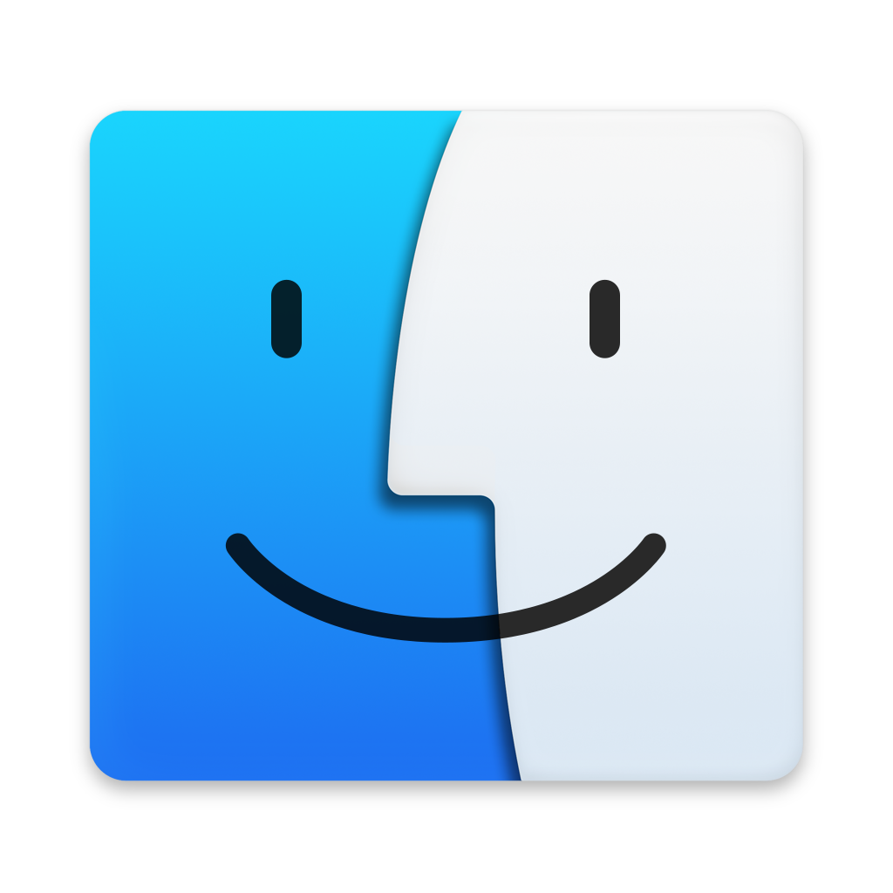
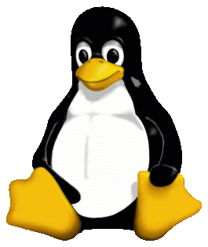

<p align="center"></p>
<h1 align="center">Lunoryx Studio</h1>
<p align="center"><a href="README.md">English</a> · <a href="README.ru.md">Русский</a></p>

Редактор 3D-сцен, моделирования, анимаций, скриптов и самостоятельных игр.

<table align="center">
<tr>
<td align="center"><a href="https://github.com/kittkanev/Lunoryx/releases/latest"></a><br/><strong>Windows x64</strong><br/><a href="https://github.com/kittkanev/Lunoryx/releases/latest">Релизы</a></td>
<td align="center"><a href="https://github.com/kittkanev/Lunoryx/releases/latest"></a><br/><strong>macOS</strong><br/><a href="https://github.com/kittkanev/Lunoryx/releases/latest">Сборки и загрузки</a></td>
<td align="center"><a href="#build-linux"></a><br/><strong>Linux</strong><br/><a href="#build-linux">Сборка из исходников</a></td>
</tr>
</table>

В текущей ветке разрабатываются папки проектов, C# и API Luaryx. [Состояние разработки](docs/work/1.3.0-plan.md). Проверенные платформы указаны в опубликованном релизе. [Источники логотипов](assets/platforms/README.md).

## Проекты и код

При запуске откроется выбор проекта. Укажите имя и папку, создайте новый проект или выберите недавний. В папке хранятся `project.lunoryx`, `scripts/`, `assets/` и снимки восстановления. **Ctrl+S** сохраняет проект. Старые форматы 1/2 поддерживаются; при первом переходе на новый формат сохраняется копия `.pre-1.3.bak`.

В **Explorer → Scripts → Create…** можно создать обычный или модульный скрипт Lua/Luaryx либо C#. Модули Lua подключаются через `require("Module1")` из скриптов этого проекта; загрузка внешних нативных модулей запрещена.

Luaryx — API поверх Lua 5.4 со стабильными ID объектов и обменом сообщениями с C#. Старые функции Lua сохранены.

```lua
local cube = luaryx.create("Cube", "cube")
cube:property("score", 10)
luaryx.emit("ready", '{"score":10}')
```

```csharp
using Luaryx;
public sealed class Main : Script {
    public override void OnStart() {
        var cube = Scene.Find("Cube");
        if (cube != null) cube.Position = new Vector3(1, 2, 3);
        Scene.Emit("ready", 10);
    }
}
```

Для C# используется настоящий процесс .NET/Roslyn. Скрипты имеют права вашей учётной записи; для загруженного проекта требуется подтвердить доверие на текущий сеанс. Зависший процесс останавливается по таймауту. Это не песочница для файлов и сети. В релиз включается среда исполнения; для сборки нужен .NET 10 SDK.

## Возможности

- Объекты и меши, трансформации, скульптинг, модификаторы, булевы операции и UV через xatlas.
- PBR-материалы, HDR, FXAA, тени солнца и текстуры.
- Анимации, персонаж, AABB-физика, триггеры, звук и дизайнер интерфейса.
- Отмена и повтор действий, восстановление, диагностика Lua и MCP.
- Сборка самостоятельной игры со сценой, ресурсами и необходимой средой C#.

Для Lua действуют ограничения памяти и инструкций. MCP по умолчанию разрешает чтение; `--allow-write` включает изменения, `--allow-lua` дополнительно разрешает исполнение Lua. Для запуска Lua через MCP нужны оба параметра. См. [границы и ограничения безопасности](docs/AUDIT-REMEDIATION.md) и [предыдущие исправления аудита](docs/AUDIT-REMEDIATION.md).

<a id="build-linux"></a>
## Сборка на Linux

Нужны компилятор C++17, Make, CMake, SDL2, Lua 5.4 и заголовки OpenGL, Rust из `rust-toolchain.toml`, .NET 10 SDK.

```sh
bash tools/prepare_modeling.sh
make -j2
dotnet publish extensions/csharp/Luaryx.Worker.csproj -c Release -r linux-x64 --self-contained true -o Runtime
./engine
```

Проверки: `make test test-integration test-physics test-rust`. Графическим тестам нужен дисплей или offscreen-драйвер SDL с OpenGL. [Русское руководство](docs/ru/README.md) · [English handbook](docs/en/README.md).

## Проверка и лицензия

Отчёт релиза содержит фактические результаты тестов, сборки платформ и известные ограничения. Конечный набор проверок не доказывает отсутствие всех возможных ошибок и уязвимостей. Неподписанная сборка не подтверждает издателя средствами ОС.

Код движка распространяется под **GPL-3.0-only**. См. [LICENSE](LICENSE), [NOTICE](NOTICE) и [лицензии зависимостей](NOTICE). Для логотипов платформ и сторонних компонентов сохраняются их собственные условия.
